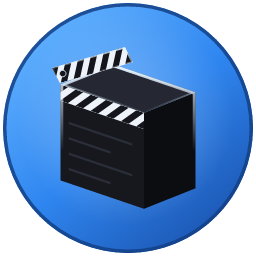
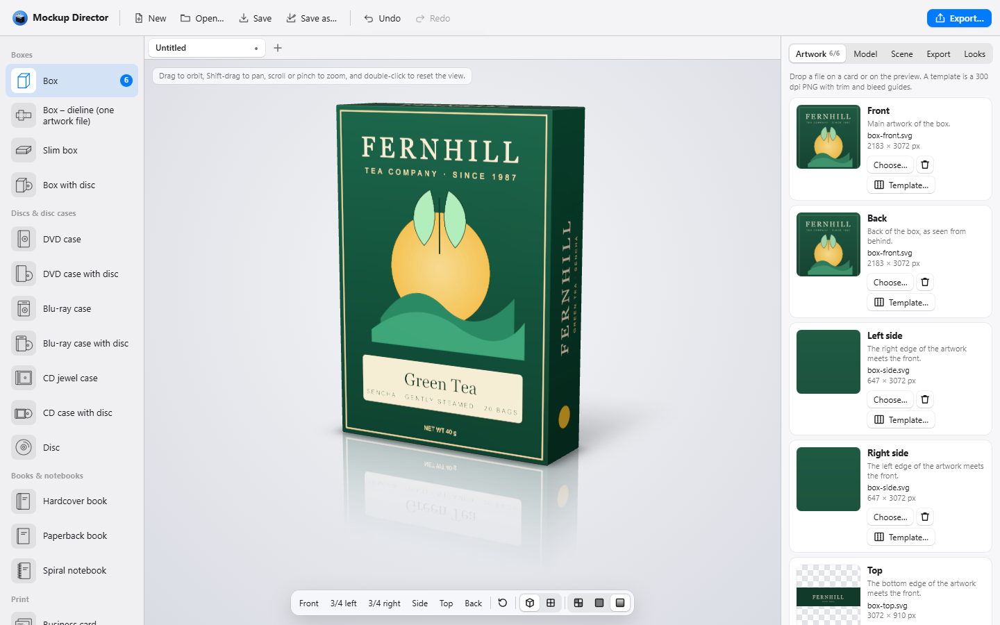
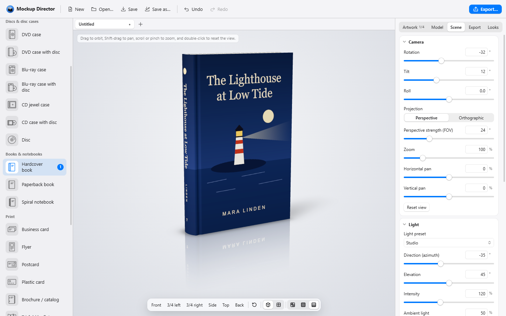
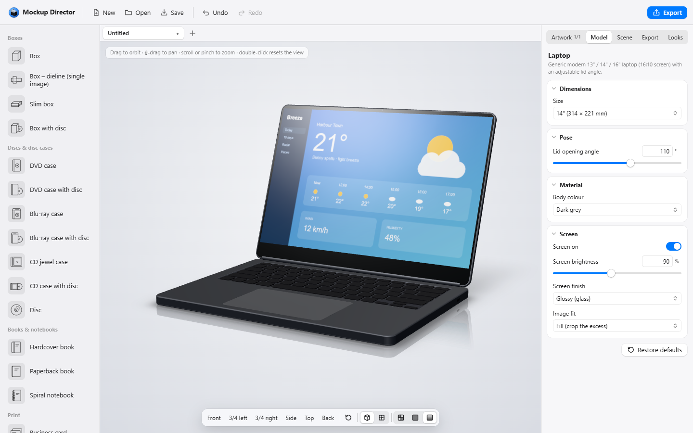
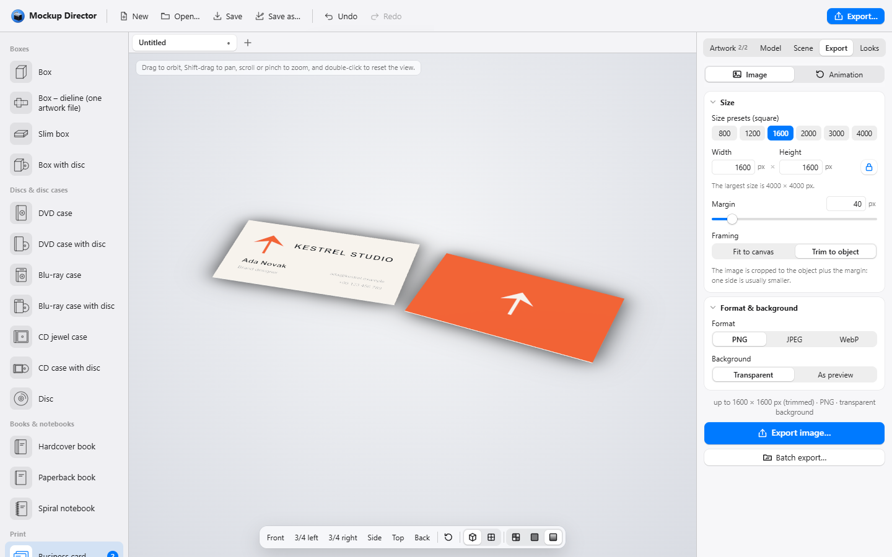

<p align="center">
  
</p>

<h1 align="center">Mockup Director</h1>

<p align="center">
  <b>Your artwork, as a real product.</b><br>
  Photorealistic 3D mockups of boxes, disc cases, books, print and devices, made on your own computer.
</p>

<p align="center">
  <a href="https://github.com/Infinitinker/Mockup-Director/releases/latest"></a>
  <a href="https://github.com/Infinitinker/Mockup-Director/actions/workflows/checks.yml"></a>
  <a href="LICENSE"></a>
  
  
</p>

Mockup Director turns flat artwork into a picture of the finished product: drop your design on a box, a DVD case, a book cover, a business card or a laptop screen, set the light, and export a photorealistic image, a turning animation, or a whole series at once. It is free and open source, runs on Windows, macOS and Linux, and works offline.

<p align="center">
  <a href="https://github.com/Infinitinker/Mockup-Director/releases/latest"><b>⬇️ Download Mockup Director for Windows, macOS and Linux</b></a>
</p>

## What it does

- 📦 **Shows your artwork on 28 models**: boxes, disc cases and discs, books and notebooks, print and devices, each sized in real millimetres. See [Models](#models).
- 📐 **Gives you print templates**: a 300 dpi PNG for each side of a printed model, with the exact size, bleed and guide lines, to design your artwork on.
- 💡 **Lights the scene like a studio**: light presets, a soft shadow, a reflection on the floor, and a transparent, solid or gradient background.
- 🖼️ **Exports images up to 4000 × 4000 px**: PNG with transparency, JPEG or WebP, ready for a shop, a website or a print proof.
- 🎞️ **Makes animations**: the product turning a full 360° or swinging back and forth, as GIF, animated WebP or MP4.
- 🗂️ **Exports in batches**: many images, views or projects in one ZIP file.
- 🔒 **Stays on your computer**: no account, no upload, no tracking. Your projects and artwork never leave your computer.

## Getting started

1. **Download and install** Mockup Director for your system; see [Installing](#installing).
2. **Pick a model** in the gallery on the left.
3. **Add your artwork** in the **Artwork** tab: drop image files on a card or on the preview.
4. **Shape the model** in the **Model** tab and **set the scene** in the **Scene** tab.
5. **Export** in the **Export** tab: an image, an animation or a batch.

Drag in the preview to turn the camera, Shift-drag to pan, scroll or pinch to zoom, and double-click to reset the view.

<table>
  <tr>
    <td></td>
    <td></td>
  </tr>
  <tr>
    <td align="center">Artwork for every side of a box</td>
    <td align="center">Camera and light for a book</td>
  </tr>
  <tr>
    <td></td>
    <td></td>
  </tr>
  <tr>
    <td align="center">A laptop and its settings</td>
    <td align="center">Exporting a business card, front and back</td>
  </tr>
</table>

## Installing

Every [release](https://github.com/Infinitinker/Mockup-Director/releases/latest) has a file for each system; `x.y.z` below stands for the version.

### Windows

Download `MockupDirector-x.y.z-windows-x64-setup.exe` and run it. It installs Mockup Director for you alone, so it needs no administrator rights; if you are an administrator, you can choose to install it for all users instead. It needs Windows 10 or 11 (64-bit) with Microsoft Edge WebView2, which comes with Windows; if it is missing, the installer downloads it.

Rather not install anything? Download `MockupDirector-x.y.z-windows-x64-portable.zip` instead, unzip it anywhere and start **Mockup Director.exe** in the folder. It keeps its data in the same place as the installed app.

### macOS

Download `MockupDirector-x.y.z-macos-universal.dmg`, open it and drag **Mockup Director** to **Applications**. It runs on Apple Silicon and Intel Macs with macOS 12 (Monterey) or later.

### Linux

Mockup Director needs 64-bit Linux (x86_64) with glibc 2.35 or newer: Ubuntu 22.04+, Debian 12+, Linux Mint 21+, Fedora 36+, openSUSE Tumbleweed / Leap 16 and similar. Download one of these files and run its command in the folder you downloaded it to:

- **AppImage**, for any distribution, without installing:

  ```bash
  chmod +x ./MockupDirector-*-linux-x86_64.AppImage && ./MockupDirector-*-linux-x86_64.AppImage
  ```

- **`.deb`**, for Debian, Ubuntu and Mint:

  ```bash
  sudo apt install ./MockupDirector-*-linux-x86_64.deb
  ```

- **`.rpm`**, for Fedora:

  ```bash
  sudo dnf install ./MockupDirector-*-linux-x86_64.rpm
  ```

  and for openSUSE (the package is not signed, so zypper would ask about it):

  ```bash
  sudo zypper install --allow-unsigned-rpm ./MockupDirector-*-linux-x86_64.rpm
  ```

The `.deb` and `.rpm` packages install the system's WebKitGTK and add Mockup Director to the applications menu; the AppImage carries its own copy.

The first time you start it, Windows or macOS may warn you about the app, and some Linux systems need FUSE for the AppImage: see [Questions](#questions).

### Check a download

The notes of every release list the SHA-256 checksum of each file. To check that a download is complete and unchanged, compare its checksum with the list: `Get-FileHash <file>` in PowerShell on Windows, `shasum -a 256 <file>` on macOS, `sha256sum <file>` on Linux. With the [GitHub CLI](https://cli.github.com/), `gh attestation verify <file> --repo Infinitinker/Mockup-Director` also shows that a file was built by this repository's Release workflow.

## Models

- **Boxes:** a product box of any size in millimetres, a slim box with a lid, a box built from one die-cut net image, and a box with a disc.
- **Discs and disc cases:** DVD and Blu-ray keep cases, CD jewel cases, CD / DVD / BD discs, and each case shown with its disc.
- **Books and notebooks:** hardcover (flat or rounded spine), paperback, and spiral-bound notebooks (Wire-O or coil, bound on the side or at the top).
- **Print:** business cards (90 × 50, 85 × 55, 89 × 51 mm or your own size, also as a stack or front and back), flyers (A6–A4, DL), postcards, plastic cards, stapled brochures, tri-fold leaflets (roll or Z fold), greeting cards and folders.
- **Devices and screens:** phone, tablet, laptop (with an adjustable lid angle), 24–34″ monitors (also curved ultrawide), a flat or curved screenshot, and a browser window. The devices are generic, with no brand logos or shapes.

## Artwork

Each side of a model has its own card in the **Artwork** tab: drop an image file on it or on the preview, or choose one from disk. PNG, JPEG, WebP, GIF, SVG and AVIF are supported. A card warns you when an image's proportions don't match its side.

Print models (boxes, cases, discs, books and print) offer a **Template** for each side: a 300 dpi PNG with the exact size, bleed and guide lines. Design your artwork on it and it fits the model exactly. Phones and tablets get a template of the screen without bleed; laptops, monitors, screenshots and browser windows have none.

## The scene and looks

The **Scene** tab sets the camera (perspective or orthographic), a light preset with its direction and colour, a soft shadow, a reflection on the floor, and the background: transparent, a solid colour or a gradient. The buttons at the bottom of the preview, or the keys 1–6, show the model from the front, 3/4 left, 3/4 right, the side, the top and the back.

The **Looks** tab has a few built-in looks (named scene settings: light, shadow, reflection, background, optionally the camera) and saves your own, to use them again in other projects. Your looks can be exported to a file and imported on another computer.

## Exporting

The **Export** tab makes:

- **an image:** PNG (with transparency), JPEG or WebP, up to 4000 × 4000 px, with a margin. PNG and JPEG also store the print resolution (DPI) in the file.
- **an animation:** the product turning a full 360° or swinging back and forth, as a GIF, animated WebP or MP4 (H.264), 1–20 seconds long. It starts from the current view and keeps the light, shadow and reflection, with one fixed framing so nothing is cropped. You can follow the progress and cancel.
- **a batch:** many mockups in one ZIP file: many images in one side of a model, several views of the current project, or many project files at once.

Some formats depend on your system's web engine: WebP export is available where the engine can encode WebP (Windows), and MP4 needs WebCodecs (Windows, or macOS 13.3 and later; on Linux it depends on the WebKitGTK version). Formats your system cannot make are shown greyed out, with a note explaining why.

## Projects and tabs

- **Projects** are saved as `.mdproj` files, which hold the model, your artwork, the scene and the export settings. Double-click one to open it in Mockup Director (the installer and the Linux packages register the file type; with the AppImage, use the app's **Open** button).
- **Tabs:** every open project is a tab above the 3D view, with its own undo history. **New** opens a new tab; **Open** opens each project in its own tab, taking the place of an untouched new tab. A project you double-click while the app is open arrives as a new tab in the same window (during an export, it opens when the export ends). A • marks a tab with unsaved changes; closing it asks whether to save them.
- **Your open tabs are saved automatically** a moment after each change and when you close the window, unsaved changes included, and come back the next time you start the app. So closing the window does not ask. On macOS, quitting the app (⌘Q, **Quit** in the Dock, logging out) skips that last save, so changes from the last second or two may be missing: close the window first, or save the project.

## Keyboard shortcuts

On macOS use ⌘ instead of Ctrl, except for switching tabs (Ctrl+Tab / Ctrl+Shift+Tab and Ctrl+PageDown / Ctrl+PageUp), which uses Ctrl on every system.

| Shortcut | Action |
| --- | --- |
| Ctrl+N or Ctrl+T | New project, in a new tab |
| Ctrl+O | Open projects, each in its own tab |
| Ctrl+S | Save the project in the active tab |
| Ctrl+W | Close the active tab |
| Ctrl+Tab / Ctrl+Shift+Tab (also Ctrl+PageDown / Ctrl+PageUp) | Next / previous tab (on macOS also ⇧⌘] / ⇧⌘[) |
| Ctrl+E | Export an image |
| Ctrl+Z | Undo |
| Ctrl+Shift+Z (or Ctrl+Y on Windows and Linux) | Redo |
| 1–6 | Preset camera views (front, 3/4 left, 3/4 right, side, top, back) |

## Questions

**Windows says "Windows protected your PC".**
Mockup Director is not code-signed yet, so Windows SmartScreen doesn't know it. Choose **More info**, then **Run anyway**. You only need to do this once.

**macOS says "Apple could not verify…" and won't open it.**
A Mac blocks apps that are not signed with an Apple Developer ID the first time. Open Mockup Director and close the message, then open **System Settings → Privacy & Security**, scroll down, and next to the message about Mockup Director click **Open Anyway**; confirm with your password or Touch ID. On macOS 15 and later, the old "right-click → Open" trick no longer works. Or run this in Terminal:

```bash
xattr -dr com.apple.quarantine "/Applications/Mockup Director.app"
```

**Linux: the AppImage says "No suitable fusermount binary found".**
FUSE is missing: install the `fuse3` package, or start the AppImage with `--appimage-extract-and-run`.

**Linux: the window stays blank or white, or the 3D preview is missing.**
This is a known WebKitGTK problem with DMA-BUF rendering, common with NVIDIA graphics and Wayland. Start the app with:

```bash
WEBKIT_DISABLE_DMABUF_RENDERER=1 mockup-director
```

For the AppImage, put the same `WEBKIT_DISABLE_DMABUF_RENDERER=1` before `./MockupDirector-*-linux-x86_64.AppImage`.

**It says "3D preview unavailable – WebGL does not work on this computer".**
Update your graphics driver; on a virtual machine, enable 3D acceleration.

**WebP or MP4 is greyed out.**
Your system's web engine cannot encode that format; see the note under the format choice and pick another one.

**Does Mockup Director go online?**
No. It makes no network connections: no accounts, no telemetry and no update check, and your projects and artwork never leave your computer.

**Can I use the mockups commercially?**
Yes. The images you export are yours, and the app contains no third-party templates, artwork or logos. If your design needs a logo such as the DVD Video, Blu-ray Disc or Apple logos, add it to your own artwork under its owner's terms.

**Where are my settings and open tabs?**
Your looks, the open tabs and a few interface choices are kept in your user profile, in a folder named after the app's identifier, `io.github.infinitinker.mockupdirector`: on Windows in `%LOCALAPPDATA%`, on Linux in `~/.local/share`, on macOS in `~/Library/WebKit`. Your projects are wherever you saved the `.mdproj` files.

**How do I update or remove it?**
To update, install the newer version over the old one: run the new installer on Windows, drag the new app to **Applications** on macOS, or install the new package or replace the AppImage on Linux; with the portable ZIP, replace its folder. Your looks and open tabs stay. To remove it, uninstall it like any other app (on Windows in Settings → Apps). Uninstalling keeps the settings folder above; delete it yourself to remove everything. On Windows, if you installed Mockup Director for you alone, the uninstaller asks whether to delete it too.

**Which version do I have?**
Hold the pointer over **Mockup Director** at the left of the toolbar.

## Contributing

New models, fixes and ideas are welcome: see [CONTRIBUTING.md](CONTRIBUTING.md). Found a security problem? Please report it privately, as [SECURITY.md](SECURITY.md) describes.

Further documentation, for developers:

- [docs/development.md](docs/development.md): building and running from source, checks, branches
- [docs/architecture.md](docs/architecture.md): how the app is built and where the code lives
- [docs/models.md](docs/models.md): adding a new 3D model
- [docs/releasing.md](docs/releasing.md): versions, releases and code signing
- [docs/licenses.md](docs/licenses.md): the dependency license policy and third-party notices

## Support

Mockup Director is free, with no ads and no tracking. If it saves you time, you can buy me a coffee:

<p>
  <a href="https://ko-fi.com/infinitinker"></a>
  <a href="https://buycoffee.to/infinitinker"></a>
</p>

Ko-fi takes cards and PayPal; buycoffee.to suits supporters in Poland, with BLIK and local bank transfers.

## License

Mockup Director is released under the [MIT license](LICENSE). Its dependencies use permissive licenses (MIT, Apache-2.0, BSD, ISC, Zlib, Unicode) and MPL-2.0; their licenses are in [THIRD-PARTY-NOTICES.md](THIRD-PARTY-NOTICES.md), which also comes with the app as `THIRD-PARTY-NOTICES.txt` (see [docs/licenses.md](docs/licenses.md)). The Linux AppImage also contains system libraries under the LGPL (GTK, WebKitGTK and their dependencies).

Mockup Director is not affiliated with the makers of the products and formats its models resemble; all trademarks belong to their owners.
